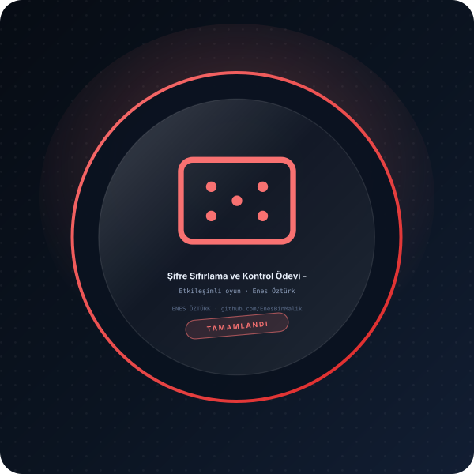

# Şifre Sıfırlama ve Kontrol Ödevi - Enes Öztürk



> **Etkileşimli oyun · durum yönetimi** — tasarım ve geliştirme: **Enes Öztürk**

---

Kullanıcı giriş ve şifre sıfırlama algoritması ödevi, canlı terminal/arayüz simülatörü ve çoklu dil kaynak kodları. Hazırlayan: Enes Öztürk.

## Öne çıkanlar

- Oyun döngüsü, durum ve skor yönetimi
- Kullanıcı etkileşimi ve hamle doğrulama
- Kazanma/kaybetme koşulları
- Arayüzde animasyon ve geri bildirim

## Kurulum ve çalıştırma

```bash
npm install
npm run dev        # http://localhost:3000
```

| Komut | Not |
| --- | --- |
| `npm install` | bağımlılıklar |
| `npm run dev` | geliştirme sunucusu |
| `npm run build` | üretim derlemesi |

## Proje yapısı

```
├── index.html
├── package.json
├── docs/rozet.svg        # imza rozeti
└── src/                  # uygulama kaynakları
```

## Lisans

Bu proje **Enes Öztürk** tarafından geliştirilmiştir; tüm hakları saklıdır.
